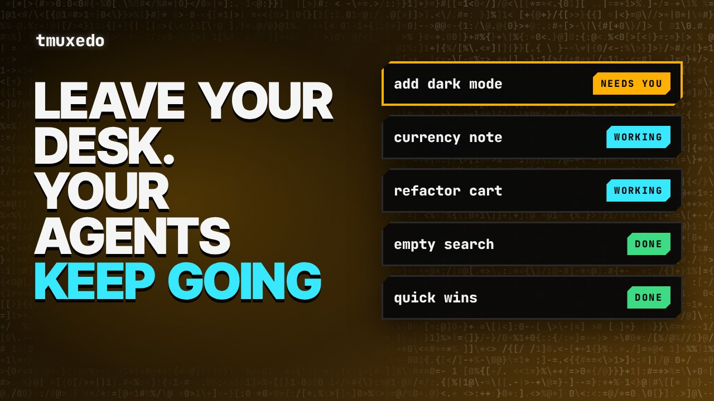
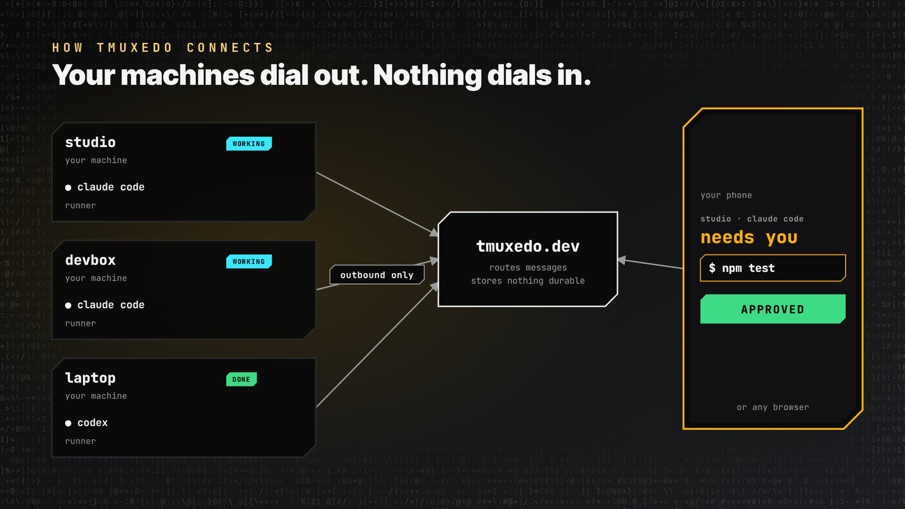
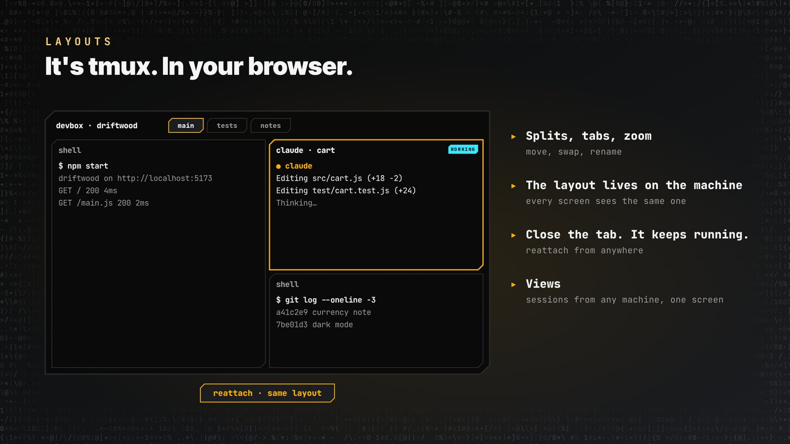
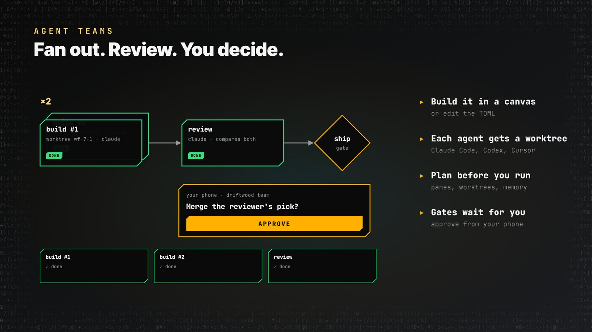
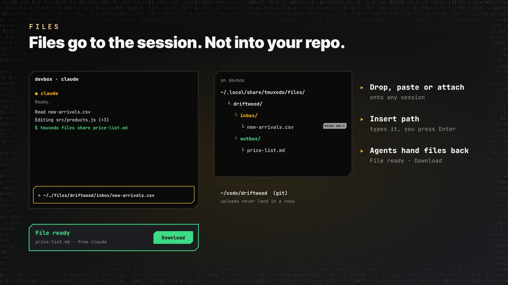

  

# tmuxedo  ·  beta

**Leave your desk. Your agents keep going.**

> **Beta.** tmuxedo is in an invite-only beta at [tmuxedo.dev](https://tmuxedo.dev): it works, it's in daily use, and it's still changing. Expect rough edges and tell us about them. The source code will be published here.
>
> **Want an invite, or to follow along?** Join our Discord: **[discord.gg/VXN6JAtWxr](https://discord.gg/VXN6JAtWxr)**

tmuxedo keeps your AI coding agents moving when you're not at your desk. Your agents run in terminals on your own computers. When one stops to ask permission, your phone shows the exact command it wants to run, and you answer with one tap.

## Nothing runs on our computers

  

A small, open-source **runner** on your Mac or Linux machine (Windows is coming) keeps your terminals alive and tells tmuxedo when an agent needs you. Your machines dial out, and nothing dials in. tmuxedo relays your terminals between those machines and your devices. Your code and your agent logins stay on your machine, and nothing runs there unless you send it.

## What it does

**Agents that need you, in one place**
- One list of every agent waiting on you, across all your machines.
- See exactly what's being asked: the command, the file, the tool.
- Approve, deny, or reply with your own instructions, from the web, your phone or your Mac.
- A notification the moment an agent is blocked, with Approve and Deny on the Lock Screen. Risky steps, like a `git push` or an `rm`, always open the app first.

**A real terminal, anywhere**
- Open any pane and watch it live, exactly as it looks on the machine.
- You start as an observer. Take control when you want to type, then give it back.
- A key row for the keys a phone keyboard lacks: Esc, Tab, Ctrl-C, the arrows and more.
- Chat when you want to talk to an agent, terminal when you want to drive. It's the same session either way.

  

**Your machines, your layout**
- Every machine you connect, with its workspaces, tabs and panes as you laid them out.
- Close the tab and it keeps running. Reattach from anywhere to the same layout.
- Views: a grid of panels built from any of your sessions, across machines.
- Works with Claude Code, Codex and many other agent CLIs.

  

**Agent teams**
- Builders, reviewers and gates working on one repo together, each agent in its own worktree.
- See the plan before you run it: panes, worktrees and memory.
- Gates wait for you, and you approve them from your phone.

  

**Files**
- Drop, paste or attach a file onto any session. It lands in that session's files folder, never in your repo.
- Agents hand files back, and you download them with one tap.

## Security first

- Two-factor sign-in on every account, with passkeys or an authenticator app.
- A fresh check before anyone takes control of a terminal or answers for an agent.
- Decisions made on your phone are signed by a key that never leaves the device.
- Every session, device and API token can be seen and revoked from Settings.

## Get it

- **Web:** [tmuxedo.dev](https://tmuxedo.dev), an invite-only beta for now.
- **iPhone:** in beta; coming soon to the App Store.
- **Mac:** a menu-bar app for your machines and the agents that need you.
- **Beta invites and updates:** [join our Discord](https://discord.gg/VXN6JAtWxr).

## Open source

tmuxedo is being prepared for an open-source release. The code, licence and contribution guide will appear in this repository.

> **The code will be beta too.** When it's published here, expect bugs, rough edges, missing docs and breaking changes between versions. Please report issues and send fixes; that's what the beta is for. Don't depend on it for anything critical yet. There's nothing to build here yet: watch or star the repository, or [join the Discord](https://discord.gg/VXN6JAtWxr), to hear when it lands.

---

© tmuxedo authors
